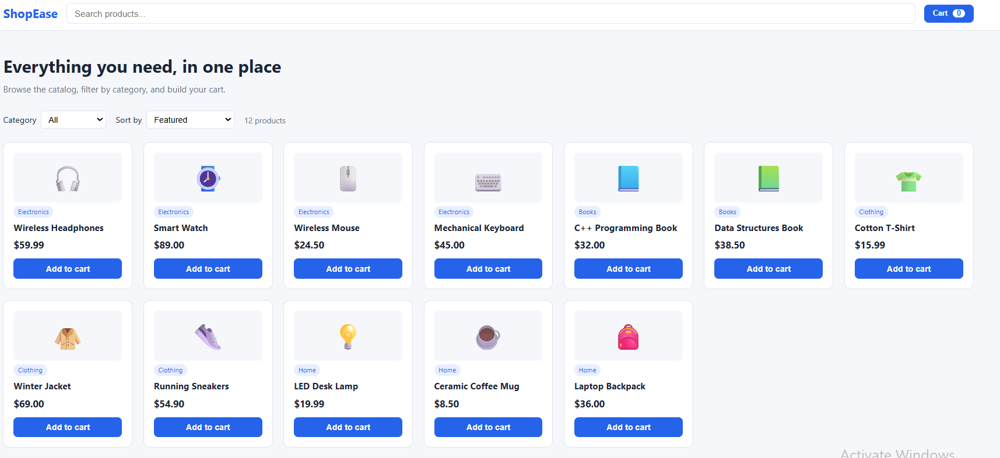
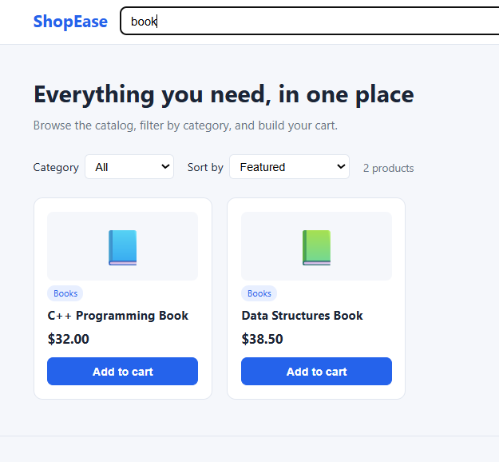
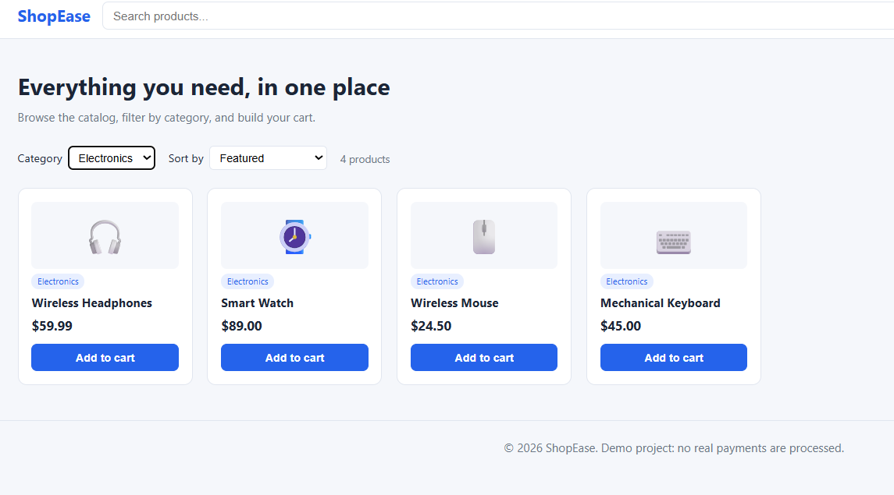
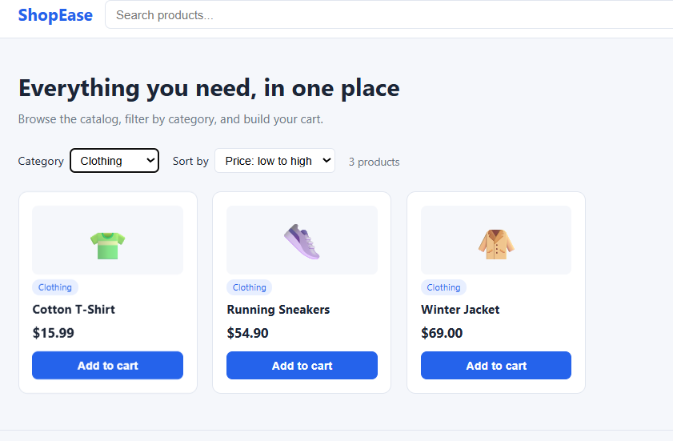
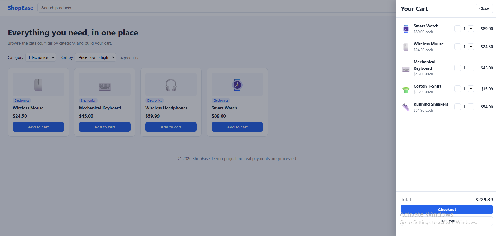
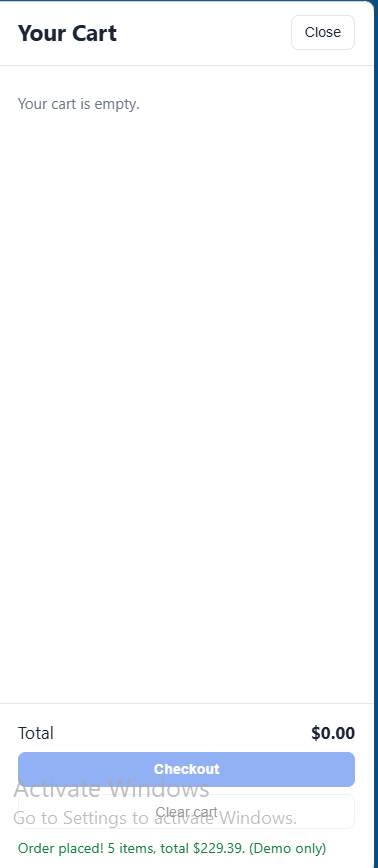
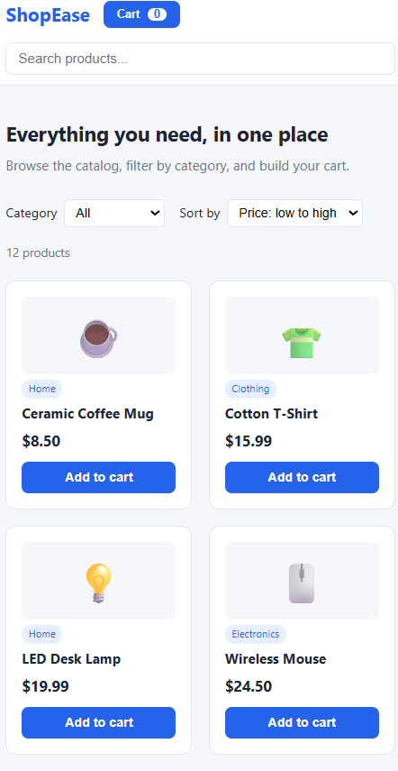

# E-commerce Website

A responsive online store front end built with HTML, CSS and JavaScript. Customers can browse a product catalog, search, filter by category, sort by price and manage a shopping cart that is remembered by the browser.

Live demo: https://rony60031.github.io/ecommerce-website/

## Screenshots

## Features

- Product catalog with 12 items in 4 categories
- Live search by product name or category
- Category filter and sorting (price low to high, high to low, name)
- Shopping cart with quantity controls, line totals and order total
- Cart saved in the browser (localStorage), so it survives a page refresh
- Simulated checkout (no real payments)
- Responsive layout for phones and desktops
- DOM built with textContent instead of innerHTML

## Technologies Used

- HTML5
- CSS3 (Flexbox, Grid, media queries)
- JavaScript (DOM, localStorage)

## Database Design

The website itself has no back end: the catalog lives in script.js. The file database/schema.sql shows how the same data (customers, products, orders, order_items) would be stored in a relational database in a future version.

## How to Run

1. Clone the repository
2. Open index.html in any web browser

## Author

Rony - https://github.com/Rony60031
